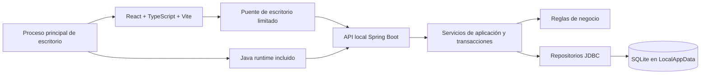
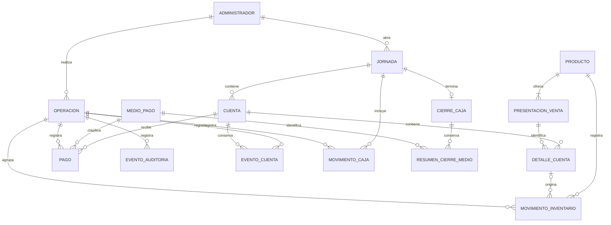

# Propuesta inicial de Bar Software

Estado: diseño inicial. La instrucción posterior de Fase 1 autoriza implementar
únicamente la base técnica y confirma Electron. Ver [Fase 1](fase-1.md) para el estado
de la base técnica. El acceso administrativo posterior está documentado en [Fase 2](fase-2.md);
el catálogo posterior en [Fase 3](fase-3.md). Las reglas de negocio pendientes de
confirmación se conservan.
Fecha: 11 de noviembre de 2026.

## 1. Inspección y alcance confirmado

El repositorio contiene README.md y las carpetas backend, frontend, database,
docs, installer y docker. No se encontraron archivos de aplicación, pruebas,
migraciones ni configuración de compilación. No hay una arquitectura existente
que deba conservarse. Docker no será un requisito de desarrollo ni de ejecución.

Decisiones confirmadas por el propietario:

- Cuentas independientes, sin mesas. No habrá entidad Mesa ni plano del bar.
- Venta de bebidas por unidad y por shot.
- Un único administrador. No se necesita gestión de empleados ni roles múltiples.
- El administrador organiza su inventario y crea sus propios productos e imágenes
  desde la aplicación, sin editar archivos técnicos ni depender de un catálogo fijo.
- Acceso con nombre de usuario y PIN. La cuenta inicial de desarrollo será `admin`
  con PIN temporal `2026`, según lo indicado por el propietario. Más adelante el
  administrador podrá personalizar ambos sin crear otra identidad ni perder sus datos.
- Se aprueba la recuperación de acceso por correo como excepción opcional: requiere
  internet y un servicio externo, sin condicionar la operación offline del bar.
- La versión inicial no emitirá ni entregará facturas, electrónicas o impresas.
  Las ventas y pagos se registrarán internamente para cuentas, caja, historial y reportes.

El alcance incluye productos, inventario trazable, cuentas simultáneas, pagos
combinados, jornadas que cruzan medianoche, caja, historial, reportes y respaldos.
La interfaz estará en español y utilizará COP inicialmente.

Se excluyen comidas, crédito y dependencias instaladas manualmente en el equipo del
bar. Los servicios externos se limitan a la recuperación opcional por correo aprobada;
la operación del bar y sus datos permanecen locales. Emisión de facturas, contabilidad fiscal,
compras a proveedores y periféricos no forman parte del alcance descrito.

## 2. Arquitectura propuesta

Aplicación local con un backend modular, una base SQLite y una ventana de escritorio.
No se necesitan microservicios ni un servidor remoto.

- Frontend: componentes, páginas por módulo, cliente de API y validación de formularios.
  Las reglas definitivas y cálculos monetarios pertenecen al backend.
- Backend: Spring Boot con paquetes por módulo; dentro de cada módulo,
  controladores, DTO, servicios, dominio y repositorios cuando sean necesarios.
- Persistencia: Spring JDBC y consultas explícitas, para controlar las particularidades
  de SQLite sin depender de un dialecto ORM adicional.
- Migraciones: SQL versionado en database/migrations, incorporado al artefacto Java.
  El ejecutor mantendrá una tabla de versiones, verificará sumas y aplicará cada
  migración de forma controlada; se elegirá la herramienta compatible antes de codificar.
- Construcción: Maven Wrapper para Java y un gestor con archivo de bloqueo para frontend.
  Las versiones exactas de JDK, Spring Boot y dependencias se fijarán al iniciar el código.
- Escritorio: instancia única, arranque y supervisión de Java, espera de disponibilidad,
  errores de inicio comprensibles y cierre ordenado del proceso secundario.

La API escuchará únicamente en 127.0.0.1 con puerto asignado al iniciar. El proceso
principal comunicará el puerto por un canal local y usará un token aleatorio por
ejecución, sin persistirlo en logs. El puente expondrá operaciones concretas, nunca
ejecución arbitraria de comandos o URLs. El renderer no accederá directamente a SQLite.
El token del proceso protege el canal local; no reemplaza el acceso con usuario y PIN.

Los archivos React compilados, fuentes y demás recursos viajarán dentro del paquete.
No habrá CDN, servidor Vite en producción, telemetría obligatoria ni descargas al iniciar.

## 3. Electron frente a Tauri

| Criterio | Electron | Tauri |
| --- | --- | --- |
| Motor visual | Incluye Chromium y Node.js | Usa WebView2 de Windows |
| RAM y tamaño | Cabe esperar mayor coste base al distribuir su motor | Cabe esperar menor coste base; el instalador offline de WebView2 reduce la ventaja en tamaño |
| Rendimiento | Adecuado para formularios y caja; medir con Java incluido | También adecuado; medir con Java y WebView2 incluidos |
| Mantenimiento | JavaScript/TypeScript más Java, motor visual versionado con la app | Rust, JavaScript/TypeScript y Java; además gestionar WebView2 |
| Backend Java | El proceso principal puede lanzar el runtime incluido | Puede lanzar un ejecutable auxiliar empaquetado |
| Instalación sin internet | Empaquetar motor, Java y recursos | Empaquetar Java y WebView2 offline o runtime fijo |

**Recomendación: Electron para la primera versión**, por la menor cantidad de
tecnologías a mantener y el control del motor visual en equipos sin internet.
Node.js estará incluido dentro de Electron; el establecimiento no deberá instalarlo.
El coste de memoria debe comprobarse en un equipo representativo antes de aceptar
la distribución definitiva. No se prometen cifras sin medir el conjunto con Java.

Tauri es una alternativa válida si la memoria es prioritaria y se acepta mantener Rust.
No debe configurarse un bootstrapper que necesite descargar WebView2 en el bar.
Esta selección fue aprobada en la instrucción posterior de Fase 1, que también
define Electron Builder para el empaquetado.

En Electron se propone sandbox, aislamiento de contexto, integración de Node
desactivada en el renderer, CSP y un preload con API mínima y validación de mensajes.

Fuentes técnicas oficiales consultadas:

- [Modelo de procesos de Electron](https://www.electronjs.org/docs/latest/tutorial/process-model).
- [Seguridad de Electron](https://www.electronjs.org/docs/latest/tutorial/security).
- [Instalador Windows y distribución offline de WebView2 en Tauri](https://tauri.app/distribute/windows-installer/).
- [Binarios auxiliares en Tauri](https://tauri.app/develop/sidecar/).
- [Paquetes Java con runtime incluido](https://docs.oracle.com/en/java/javase/25/jpackage/packaging-overview.html).

## 4. Persistencia, instalación y recuperación

Ubicación propuesta: %LOCALAPPDATA%\BarSoftware\data\bar.db. Los logs y respaldos
usarán subcarpetas separadas de BarSoftware. La instalación y desinstalación normal
no eliminarán datos. Esta ruta pertenece al usuario Windows: cambiar de usuario no
debe crear la expectativa de ver automáticamente la misma base.

Las imágenes que el administrador seleccione desde el equipo o una memoria USB se
copiarán a %LOCALAPPDATA%\BarSoftware\media\productos. No se conservará una
dependencia de la ubicación original: retirar la USB o mover la foto original no
afectará al catálogo. SQLite guardará un identificador y una ruta relativa administrada,
no la ruta absoluta del archivo elegido. Las imágenes serán opcionales; un producto
sin foto mostrará un marcador visual.

La importación validará el contenido como imagen, su tamaño y dimensiones, y generará
nombres internos únicos. Los límites y formatos se concretarán en el diseño del módulo.
La sustitución de una imagen publicará primero el archivo nuevo y después actualizará
su referencia; un fallo conservará la imagen anterior. La limpieza de archivos sin
referencias deberá respetar los respaldos en curso.

El instalador x64 contendrá Electron, frontend compilado, JAR, controlador SQLite
y runtime Java redistribuible compatible. Se probará desde USB en Windows 10 y 11
limpios y desconectados. Node, Maven y el JDK serán herramientas de construcción,
no requisitos para el negocio. Los términos de redistribución del runtime elegido
se revisarán al empaquetar.

SQLite tendrá claves foráneas habilitadas en **cada conexión**, restricciones CHECK,
índices y transacciones breves. Se propone WAL con sincronización FULL y espera
limitada ante bloqueos; se validará con el controlador elegido. Una sola instancia
y escrituras coordinadas reducirán conflictos sin ocultar fallos.

Las copias usarán la API de backup de SQLite o VACUUM INTO mediante una ruta
probada con el controlador. No se copiará a ciegas una base abierta con WAL.
Se propondrán respaldos manuales, al cerrar jornada y antes de migrar; frecuencia,
retención y destino externo quedan pendientes. Una copia en el mismo disco no
protege frente a la pérdida del equipo.

El respaldo completo incluirá la base y las imágenes referenciadas, con un manifiesto
de versión e integridad. Se coordinará con los cambios de imágenes para que el conjunto
sea coherente. La restauración validará y recuperará ambos como una sola entrega;
copiar únicamente bar.db no será un respaldo completo del catálogo con imágenes.

Restauración: detener nuevas operaciones, validar integridad, claves foráneas y
versión del respaldo, crear una copia de seguridad previa, cerrar conexiones y
sustituir de forma recuperable la base. Reiniciar y verificar antes de volver a vender.
No se restaurará una versión futura incompatible. Se documentará el efecto de perder
las operaciones posteriores al respaldo elegido.

Referencias: [backup SQLite](https://www.sqlite.org/backup.html) y
[claves foráneas SQLite](https://www.sqlite.org/foreignkeys.html).

## 5. Modelo entidad-relación propuesto

| Entidad | Datos y finalidad |
| --- | --- |
| Administrador | Identidad única estable, nombre de usuario editable, hash del PIN con sal y correo de recuperación con estado de verificación; sin borrado histórico |
| Jornada | Apertura, cierre, estado, fondo inicial, moneda y administrador |
| Cuenta | Identificador, nombre o referencia, jornada, estado, apertura, cierre y versión para concurrencia |
| DetalleCuenta | Presentación, cantidad entera, nombre y precio históricos, consumo base histórico y versión |
| EventoCuenta | Altas, cambios de cantidad y anulaciones con motivo, valores anterior/nuevo y operación |
| Producto | Nombre, categoría opcional, estado, unidad base de inventario y referencia opcional a imagen local administrada |
| PresentacionVenta | Producto, etiqueta unidad/shot, precio, consumo de inventario por venta y estado |
| MovimientoInventario | Producto, cantidad base con signo, tipo, motivo, fecha, operación y detalle origen opcional |
| MedioPago | Nombre y clasificación que determine si afecta efectivo; conservar significado histórico |
| Pago | Cuenta, medio, importe aplicado, fecha y operación; se registra en el cierre atómico de cuenta |
| MovimientoCaja | Entrada/salida ajena a ventas, importe, motivo y operación; módulo sujeto a confirmar necesidad |
| CierreCaja | Jornada única, efectivo esperado, contado, diferencia, total vendido y administrador |
| ResumenCierreMedio | Totales históricos por medio de pago al cerrar jornada |
| Operacion | Identificador único de petición, administrador, tipo, huella de solicitud y resultado para reintentos |
| EventoAuditoria | Entidad, identificador, acción, fecha y cambios relevantes vinculados a operación |
| Configuracion | Moneda inicial, zona horaria y preferencias; cambios no reinterpretan jornadas históricas |

No se necesita una tabla Venta que duplique Cuenta: una cuenta cerrada representa
una venta. No se necesita una tabla Cliente para abrir una cuenta con una referencia.

El inventario se obtiene sumando movimientos; no se sobrescribe una existencia sin
su movimiento justificante. Una proyección de saldo podría añadirse si se mide necesidad,
actualizada dentro de la misma transacción y reconciliable con los movimientos.

### Unidades y shots

Para productos vendidos por unidad se propone inventario en unidades enteras.
Para una bebida fraccionada se propone inventario en mililitros enteros y una
presentación shot con consumo configurable. Ejemplo ilustrativo, no regla aprobada:
una entrada de 750 ml y un shot de 30 ml permitirían 25 shots sin considerar mermas.

Si se vende también la botella completa, una presentación puede consumir 750 ml
del mismo producto. Este modelo mide volumen total, pero **no distingue botellas
selladas de abiertas**. Si se necesita asegurar disponibilidad de botellas selladas,
habrá que añadir envases y una operación de apertura antes de implementar inventario.
No se fija todavía volumen del shot, merma ni política de devolución al disminuir pedidos.

## 6. Reglas e integridad

Confirmadas por el documento y las respuestas:

- Varias cuentas abiertas independientes; cada una pertenece a una jornada.
- Cerrar una cuenta exige saldo cero y admite varios medios de pago.
- Cuenta cerrada y jornada cerrada no se editan directamente ni se eliminan.
- Cambiar precios no modifica consumos ya registrados: el detalle conserva su precio.
- Operaciones importantes conservan la identidad del administrador, aunque sea único.
- El dashboard filtra por identificador de jornada activa; no por la fecha del equipo.
- Ajustes de stock, pagos y cambios de cantidades tienen trazabilidad.
- El administrador crea y edita sus productos, agrega o reemplaza sus imágenes y
  registra existencias iniciales, entradas y ajustes mediante movimientos trazables.
  El catálogo operativo lo define el administrador; los datos de demostración no se
  incorporarán automáticamente al inventario real.

### Acceso y recuperación

El usuario y el PIN son credenciales de acceso, independientes del identificador
interno del administrador. Personalizarlos o restablecer el PIN no crea una base nueva,
no borra datos y no cambia la autoría de operaciones históricas. No habrá una función
de recuperación que reinstale el programa o vacíe el inventario.

El PIN no se almacenará en texto plano ni aparecerá en logs: se guardará mediante
una función de hash de credenciales con sal individual. Se propone limitar intentos
con esperas progresivas. El PIN inicial indicado es temporal para desarrollo; se
propone exigir su personalización al preparar el primer uso real. No será un PIN
maestro ni un mecanismo de recuperación permanente.

El propietario aprueba recuperar el acceso mediante correo, con internet y un servicio
externo, como excepción opcional al alcance offline. Quedan pendientes la selección
del proveedor y el diseño de la vinculación segura entre instalación, administrador
y correo verificado. Esta aprobación no autoriza subir la base, el catálogo, las
imágenes ni el historial al servicio de recuperación. Su indisponibilidad no bloqueará
el acceso con credenciales válidas ni las operaciones locales del bar.

Propuesta: recuperación offline mediante un código generado aleatoriamente, mostrado
al configurar el acceso y conservado por el propietario fuera del equipo. Se guardará
solo su hash, se invalidará al usarlo y se generará otro tras recuperar el acceso.
Se propone verificar el PIN actual para cambiar credenciales y exigir la prueba de
recuperación para restablecer un PIN olvidado. El flujo se auditará sin registrar secretos.

Para la recuperación por correo aprobada, deberá verificarse la dirección y diseñar
un servicio que valide códigos de un solo uso, con vencimiento y límite de intentos.
No bastará con escribir una dirección para recuperar acceso; no se incluirán claves
privadas de envío dentro del instalador. Ventas, inventario y caja seguirán funcionando
sin conexión; la recuperación por correo estará disponible solo con internet.
La recuperación de acceso no sustituye al respaldo frente a pérdida o daño del equipo.

Propuestas que requieren confirmación de negocio:

- Una sola jornada abierta y cierre bloqueado si quedan cuentas abiertas.
- Descontar inventario al agregar consumo a la cuenta, para reflejar bebidas servidas.
- Bloquear cantidades que excedan existencias; registrar merma en vez de devolver
  automáticamente stock cuando una bebida ya fue servida.
- Efectivo esperado = fondo inicial + pagos en efectivo + entradas de caja − salidas.
  Diferencia = efectivo contado − esperado; positiva es sobrante, negativa faltante.
- Registrar pagos únicamente al cerrar la cuenta; anticipos parciales durante el consumo
  necesitarían un flujo adicional que no está confirmado.
- Correcciones posteriores mediante operaciones compensatorias auditadas, sin reescribir
  jornadas cerradas; devoluciones y anulaciones de ventas requieren una política acordada.

Decisiones técnicas propuestas:

- Dinero como enteros en unidades monetarias menores, nunca float; cálculo Java exacto.
  En COP, la pantalla puede mostrar pesos enteros. No convertir automáticamente datos
  históricos al cambiar moneda; cada jornada conserva moneda y escala.
- Cantidades de venta enteras positivas; consumo en unidad base explícita, sin sumar ml
  y unidades ni cambiar la unidad base de un producto con movimientos.
- Claves foráneas con borrado restringido; productos usados se desactivan.
- Fecha/hora persistida como instante y visualizada en America/Bogota inicialmente.
- Índices en jornada/estado de cuentas, cuenta de pagos y producto/fecha de movimientos.
- Un índice único parcial puede asegurar una jornada activa si se aprueba esa regla.
- Cierre de cuenta: validar jornada y cuenta abiertas, versión y totales; registrar pagos,
  estado y auditoría en una transacción. Una diferencia de pago provoca rollback completo.
- Alta o modificación de consumo: detalle, evento e inventario cambian juntos.
- Cierre de jornada: verificar condiciones y calcular resumen, conteo, diferencia y bloqueo
  en una transacción. El respaldo posterior no debe repetir el cierre si falla.
- Peticiones con UUID único: mismo identificador y contenido devuelve el resultado previo;
  mismo identificador con contenido distinto se rechaza. La clave y el resultado se
  confirman en la misma transacción que la operación de negocio.
- Los totales entre varias filas se validan en servicios transaccionales; un CHECK de fila
  no basta. Se usarán restricciones y triggers donde aporten protección a datos cerrados.
- Los errores indican si la operación fue confirmada; ante incertidumbre se consulta
  la operación antes de reintentar. No se borran archivos de base ante un error de arranque.

## 7. Módulos y pantallas

| Módulo | Pantallas y acciones |
| --- | --- |
| Inicio | Jornada activa, ventas, cuentas abiertas, productos más vendidos, caja y alertas de stock; si no hay jornada, ofrecer apertura |
| Cuentas | Lista de cuentas por referencia, búsqueda, abrir cuenta y detalle con catálogo, cantidades y total |
| Cobro | Resumen, distribución entre medios, validación del total y confirmación de cierre |
| Productos | Crear y editar productos propios, precio, estado, presentaciones por unidad o shot y selección de imagen local con vista previa |
| Inventario | Organización y consulta del inventario del administrador, existencias iniciales, entradas, ajustes con motivo e historial de movimientos |
| Caja | Apertura, fondo inicial, pagos por medio, efectivo esperado, conteo y confirmación de cierre |
| Historial | Jornadas anteriores, cuentas cerradas, pagos y diferencias; consulta sin edición |
| Reportes | Ventas por jornada/período, productos vendidos y movimientos; exportación por definir |
| Configuración | Moneda, personalización de usuario y PIN, recuperación de acceso, respaldo y restauración |

Navegación lateral fija, tarjetas breves y tablas legibles. Los formularios validan
sin perder datos y las confirmaciones muestran importes y consecuencias concretas.
No habrá selector de mesas ni pantallas de gestión de empleados. Los bocetos de
pantalla se presentarán después de aprobar el modelo, antes de desarrollar la interfaz.

## 8. Decisiones pendientes

Antes de comenzar la base técnica:

1. Aprobar esta arquitectura y Electron como contenedor inicial.
2. Acceso definido: usuario y PIN, inicialmente `admin` y el PIN temporal indicado por
   el propietario. Correo aprobado como excepción opcional con internet y servicio
   externo; quedan por definir proveedor y vinculación segura. Confirmar el código
   de recuperación offline propuesto como mecanismo adicional.

Antes del módulo de inventario y cuentas:

3. ¿Qué volumen tiene cada shot? ¿Es igual para todas las bebidas o configurable?
4. ¿Se venderán botellas completas del mismo licor y hay que distinguir selladas/abiertas?
5. ¿Se descuenta al servir/agregar a la cuenta? ¿Cómo se corrigen pedidos ya servidos,
   mermas y errores? ¿Se debe bloquear siempre una venta sin stock?
6. ¿Una sola jornada activa y cierre únicamente cuando no queden cuentas abiertas?
7. ¿Qué medios de pago se habilitan? ¿Se necesitan anticipos antes del cierre?

Antes de caja, reportes y distribución:

8. ¿Se necesitan retiros y entradas de efectivo distintos de las ventas?
9. ¿Se permiten descuentos, propinas o devoluciones? No se implementarán sin reglas.
10. ¿Se necesita exportar reportes administrativos a CSV/PDF? La emisión de facturas
    está excluida de esta versión; cualquier comprobante no fiscal o periférico
    adicional requerirá definir su alcance por separado.
11. ¿Dónde guardar respaldos externos y cuántos conservar?
12. ¿Cuál es la memoria RAM y resolución del equipo objetivo? ¿Se usará siempre el
    mismo usuario Windows? Esto permite validar rendimiento y ubicación de datos.

## 9. Plan por etapas y criterios de aceptación

| Etapa | Entrega y validación |
| --- | --- |
| 1. Requisitos | Aprobar alcance, arquitectura y preguntas necesarias para el siguiente módulo |
| 2. Base técnica | React/Vite, Spring Boot, Wrapper y configuración local; compilación reproducible |
| 3. Datos | Migraciones y repositorios; restricciones, rollback y conservación al reiniciar |
| 4. Interfaz | Bocetos en español de cuentas, cobro y caja; revisión del flujo antes del desarrollo funcional |
| 5. Productos e inventario | Catálogo propio con imágenes locales, presentaciones y movimientos; verificar persistencia al retirar la USB, consumo por unidad/shot, ajustes y límites |
| 6. Jornadas y cuentas | Apertura, cuenta y cambios auditados; validar cruce de medianoche y conservación de precios |
| 7. Pagos y caja | Pagos combinados, cierre atómico e idempotencia; detectar faltantes y bloquear cierres inválidos |
| 8. Historial y reportes | Consultas separadas del inicio; reconciliar ventas, pagos, stock y cierres con datos conocidos |
| 9. Integración de escritorio | Supervisión de Java, instancia única, puente seguro y recuperación tras caída |
| 10. Respaldos e instalador | Restauración de base e imágenes probada, actualización con datos, instalación USB y ejecución sin internet en Windows limpio |
| 11. Entrega | Manual operativo, recuperación, guía técnica y recorrido completo de una jornada |

Cada módulo se desarrolla de extremo a extremo: diseño breve, backend, interfaz,
integración y pruebas pertinentes antes de avanzar. El instalador se valida de forma
temprana con una prueba mínima tras aprobar la arquitectura, aunque su entrega final
sea posterior; así se detectan pronto problemas del runtime Java o de Windows.

Casos críticos de aceptación: doble clic no duplica cobros; fallo entre pago y cierre
no deja una operación parcial; no se pierde stock por reintentos; reiniciar conserva
cuentas abiertas; una jornada que cruza medianoche conserva todas sus ventas;
los cambios de catálogo no alteran el historial; restaurar recupera una base íntegra.

La Fase 1 posterior autoriza y documenta la base técnica. Los módulos funcionales
y las decisiones de negocio pendientes conservan el proceso de diseño y aprobación.
